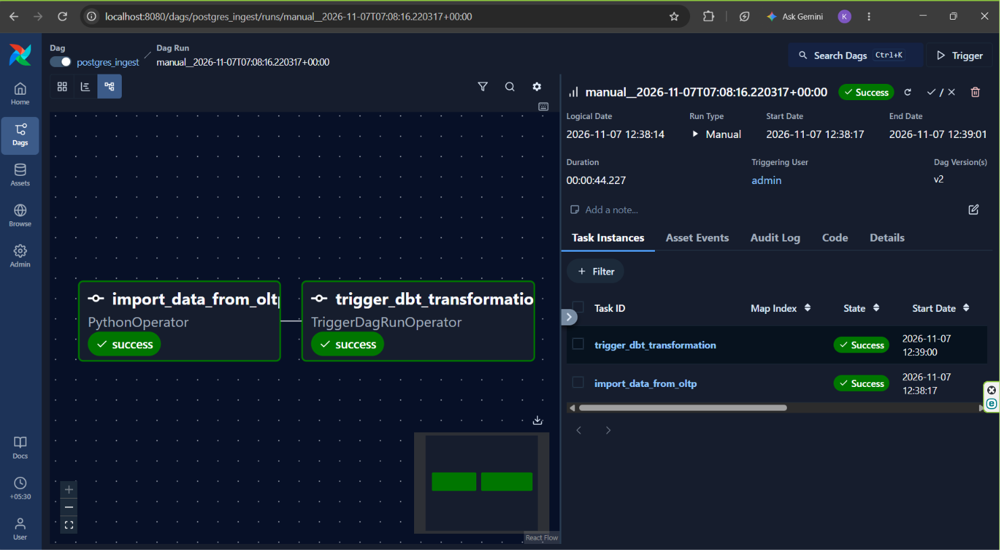
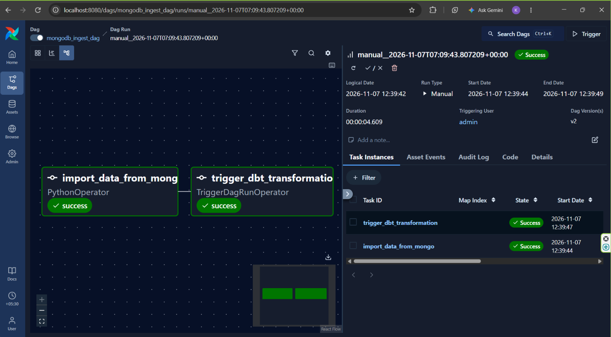
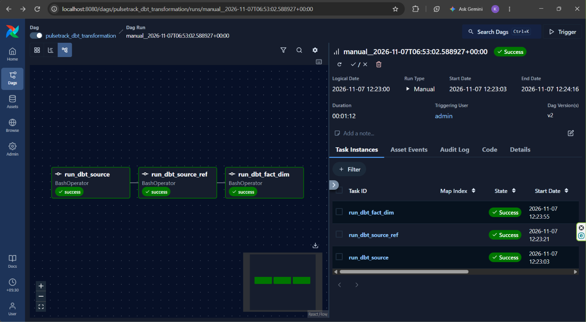
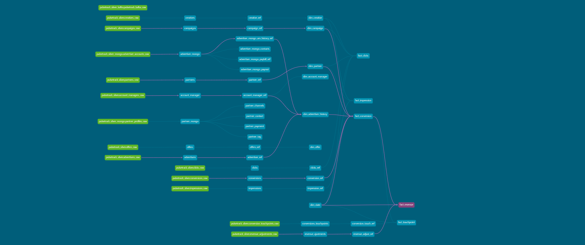

PulseTrack – End-to-End Data Engineering Project

An end-to-end data engineering and analytics platform built using Apache Airflow, PostgreSQL, MongoDB, dbt, and Power BI.

PulseTrack integrates data from multiple sources, orchestrates automated data ingestion, applies data transformations using a Medallion Architecture, and delivers analytical insights through Power BI dashboards.

Project Overview

The project demonstrates a modern data engineering workflow, covering data ingestion, data warehousing, transformation, orchestration, and business intelligence.

Technologies Used

Technology                                  Purpose

Python                            Data ingestion and processing

Apache Airflow                    Workflow orchestration

PostgreSQL                        Source database and data warehouse

MongoDB                           NoSQL data source

dbt                               Data transformation and modeling

SQL                               Data extraction and transformation

Power BI                          Data visualization and analytics

Git & GitHub                      Version control

Airflow DAG Graph
  

dbt Lineage Graph

