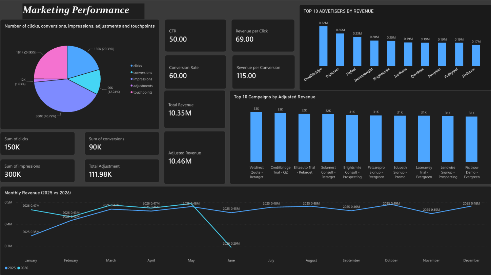

## PulseTrack – End-to-End Data Engineering Project

## About PulseTrack

PulseTrack is a digital advertising analytics platform that helps businesses monitor and analyze advertising campaigns, track impressions, clicks, conversions, and revenue, and gain valuable insights into campaign performance.
An end-to-end data engineering and analytics platform built using Apache Airflow, PostgreSQL, MongoDB, dbt, and Power BI.

PulseTrack integrates data from multiple sources, orchestrates automated data ingestion, applies data transformations using a Medallion Architecture, and delivers analytical insights through Power BI dashboards.

## Project Overview

The project demonstrates a modern data engineering workflow, covering data ingestion, data warehousing, transformation, orchestration, and business intelligence.

## Technologies Used

Python     ->                      Data ingestion and processing

Apache Airflow      ->              Workflow orchestration

PostgreSQL          ->              Source database and data warehouse

MongoDB            ->               NoSQL data source

dbt              ->                 Data transformation and modeling

SQL              ->               Data extraction and transformation

Power BI          ->                Data visualization and analytics

Git & GitHub         ->             Version control

## Data Pipeline

## 1. Data Ingestion

Apache Airflow orchestrates data extraction from:

-> PostgreSQL OLTP database. 
-> MongoDB database

Python and PostgreSQL hooks are used to manage ingestion workflows.

## 2. Bronze Layer

Raw ingested data is stored in PostgreSQL data warehouse schemas. 
The Bronze layer preserves source data for downstream processing.

## 3. Data Transformation

dbt is used to transform and organize the ingested data into: 
Silver Layer – cleaned and transformed data. 
Gold Layer – analytical fact and dimension models. 

dbt Lineage Graph

## 4. Data Visualization

Power BI is used to create dashboards and visualize analytical data from the Gold layer. 

## Workflow Orchestration

The Airflow DAGs manage the ingestion and transformation workflows. 
Python and PostgreSQL hooks are used to manage ingestion workflows.

 

## Key Features

-Multi-source data ingestion. 
-PostgreSQL and MongoDB integration. 
-Workflow orchestration using Apache Airflow. 
-Medallion Architecture implementation. 
-Data transformation using dbt. 
-Fact and dimension modeling. 
-Business intelligence dashboards using Power BI. 

Developed as a hands-on Data Engineering project to explore modern data engineering technologies and build practical experience in designing end-to-end data pipelines.

